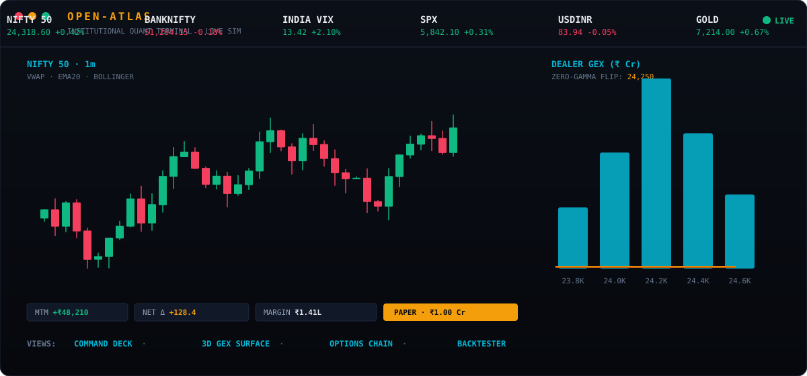
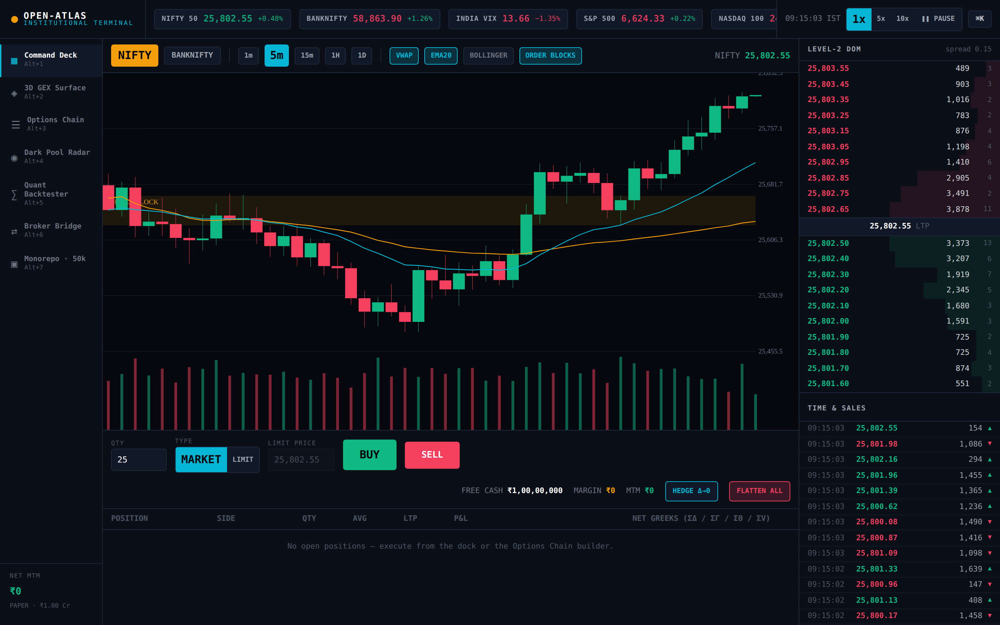
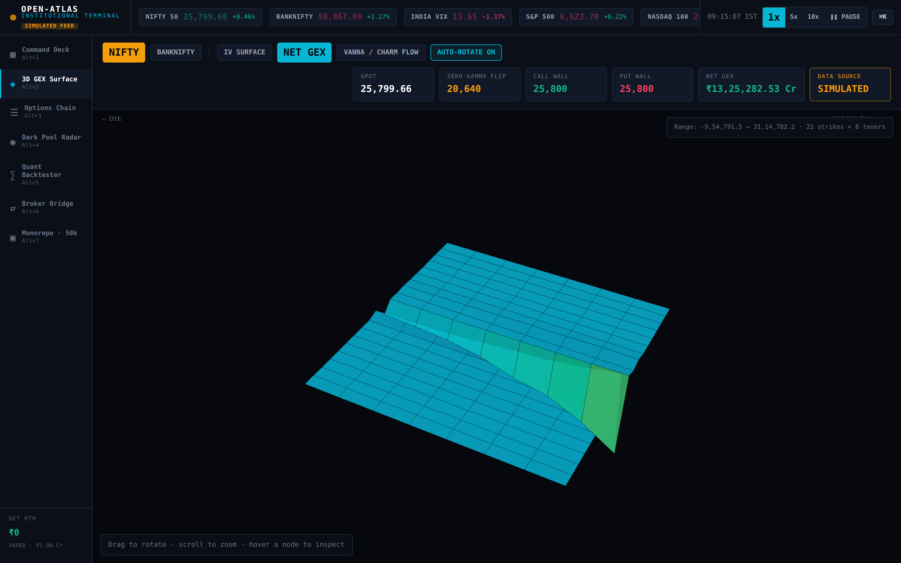
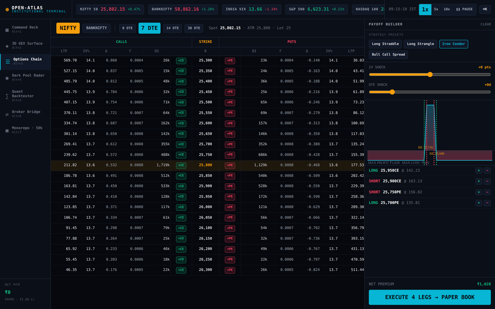
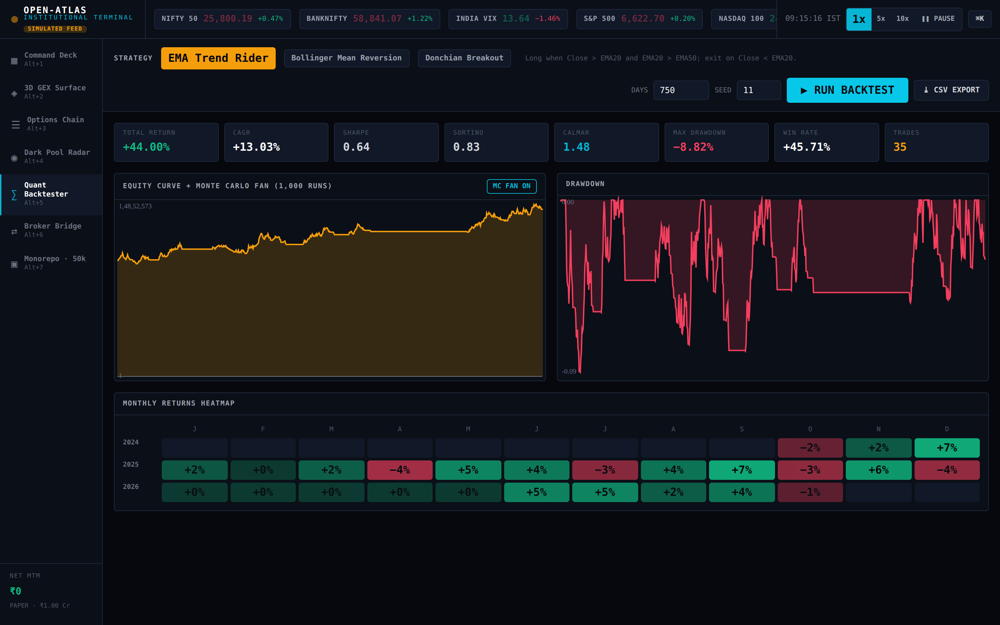
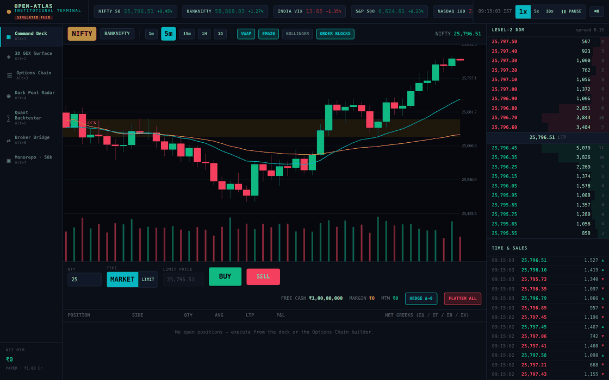
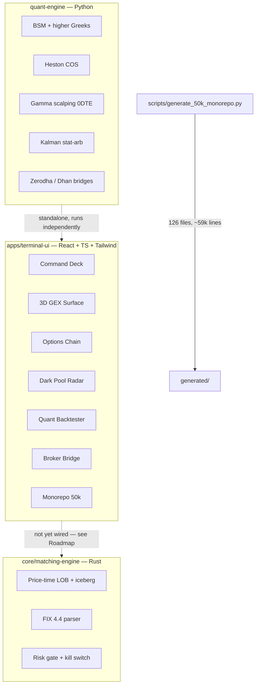

# OPEN-ATLAS

### Institutional-style quantitative trading terminal, 3D gamma-exposure analytics and a low-latency orderflow engine — open source, MIT licensed.



[](LICENSE)
[](quant-engine/requirements.txt)
[](core/matching-engine/Cargo.toml)
[](apps/terminal-ui/package.json)
[](apps/terminal-ui/package.json)
[](https://github.com/Thegreatprabh/Open-Atlas/actions/workflows/ci.yml)

OPEN-ATLAS is a quant research and paper-trading platform built as a monorepo. It has three parts that actually
run: a **React web terminal** with a live market-microstructure simulator (no backend, no API keys, everything in the
browser), a **Python quant engine** (Black–Scholes–Merton analytics through higher-order Greeks, Heston calibration,
gamma-scalping and stat-arb strategies, broker bridges), and a **Rust matching engine** (price–time-priority limit order
book, FIX 4.4 parser, percentage-of-notional risk gate).

Be clear about what this is: **the hand-written core is ~12,400 lines** (table below). There is also a generator
script that can expand the repo with ~59,000 additional lines — that output is template-generated strategy code plus
synthetic tick CSVs, it is **not committed to this repo**, and you should treat it as scaffolding, not as the project's
substance. The substance is the code listed under [What's actually in here](#whats-actually-in-here).

Everything claimed here is reproducible from a fresh clone: Rust tests pass 24/24 (`cargo test`), every Python module
runs end to end, the terminal builds cleanly with `tsc && vite build`, CI re-checks all of it on every push, and the
screenshots below were captured from the real built app, not mockups.

---

## Links

Everything worth finding, in one place:

| What | Where |
|---|---|
| This repository | <https://github.com/Thegreatprabh/Open-Atlas> |
| Web terminal (source) | [`apps/terminal-ui/`](https://github.com/Thegreatprabh/Open-Atlas/tree/main/apps/terminal-ui) |
| Run the terminal locally | [Installation → Run the terminal UI](#2-run-the-terminal-ui) |
| Deploy it yourself | [](https://vercel.com/new/clone?repository-url=https%3A%2F%2Fgithub.com%2FThegreatprabh%2FOpen-Atlas&root-directory=apps/terminal-ui) — set build command to `npm run build`, output directory to `dist` |
| Rust matching engine | [`core/matching-engine/`](https://github.com/Thegreatprabh/Open-Atlas/tree/main/core/matching-engine) |
| Python quant engine | [`quant-engine/`](https://github.com/Thegreatprabh/Open-Atlas/tree/main/quant-engine) |
| 50k-line expansion generator | [`scripts/generate_50k_monorepo.py`](https://github.com/Thegreatprabh/Open-Atlas/blob/main/scripts/generate_50k_monorepo.py) |
| Demo screenshots | [`assets/demo/`](https://github.com/Thegreatprabh/Open-Atlas/tree/main/assets/demo) |
| Math reference (BSM / GEX / margin) | [Quantitative core](#quantitative-core) |
| Engineering audit & issue register | [`docs/ISSUE_REGISTER.md`](https://github.com/Thegreatprabh/Open-Atlas/blob/main/docs/ISSUE_REGISTER.md) |
| Report a bug / ask a question | <https://github.com/Thegreatprabh/Open-Atlas/issues> |

---

## Screenshots

Captured from the real built terminal with Playwright (1440×900 @2x) — these are actual screenshots,
not mockups.

**Command Deck** — live candlesticks, Level-2 depth, time & sales, order dock, paper positions:



**3D GEX Surface** — implied-volatility / dealer-gamma mesh with spot, zero-gamma flip, call/put walls:



**Options Chain** — 21-strike chain with full Greeks and an Iron Condor loaded in the payoff builder:



**Quant Backtester** — equity curve, 1,000-run Monte Carlo fan, drawdown and monthly heatmap:



Animated walkthrough of the live views:



---

## What's actually in here

Hand-written code only — generator output excluded:

| Module | Lines | What it is | How it's verified |
|---|---|---|---|
| `apps/terminal-ui/src` | ~4,400 | React + TS terminal, 7 views, 4 quant engines | `npm run build` (tsc + vite) in CI |
| `core/matching-engine/src` + `examples/` | ~2,200 | Rust LOB, FIX 4.4 parser, risk gate, FIX gateway binary, bench | `cargo test` 35/35 + gateway E2E in CI |
| `quant-engine` | ~1,700 | BSM Greeks, Heston, 2 strategies, 2 broker bridges, validated API server | modules executed + BSM correctness suite in CI |
| `scripts` | ~4,000 | 50k generator only (verified run: 59,251 lines / 126 files) | generator self-verifies ≥50k lines |

The terminal's live simulation runs on the **TypeScript engine in the browser**. The Rust engine and the Python engine
are standalone, tested components — they are **not wired into the UI yet** (see [Roadmap](#roadmap)). The generator's
output lives in `generated/` (gitignored by design) and is roughly half synthetic tick CSVs, half template-generated
code — useful for load-testing and demos, not a substitute for the core above.

### Benchmarks (measured, not promised)

Single-threaded, 200k-order loops, release build, on a 2-vCPU AMD EPYC VM (Oct 2026):

| Operation | Throughput | Per order |
|---|---|---|
| Resting inserts | 5.3M /sec | 189 ns |
| Crossing inserts (matched) | 6.3M /sec | 158 ns |
| Cancels | 4.2M /sec | 236 ns |

Reproduce on your own machine: `cd core/matching-engine && cargo run --release --example bench`.
Your numbers will differ — hot-cache loop throughput is not the same as production latency. Treat this as an
indication of the engine's order of magnitude, not a latency guarantee.

---

## Installation

You need **Git**, **Node 18+**, **Python 3.10+** and **Rust** (cargo). Docker is optional. The steps below are written
per platform — pick yours and follow it top to bottom.

### 0. Clone the repo

```bash
git clone https://github.com/Thegreatprabh/Open-Atlas.git
cd Open-Atlas
```

### 1. Install prerequisites

<details>
<summary><b>Linux (Debian/Ubuntu)</b></summary>

```bash
# system tools
sudo apt update && sudo apt install -y git curl build-essential

# Python 3.10+
sudo apt install -y python3 python3-venv python3-pip
python3 --version

# Node 18+ (NodeSource)
curl -fsSL https://deb.nodesource.com/setup_20.x | sudo -E bash -
sudo apt install -y nodejs
node --version   # expect v20.x or newer

# Rust
curl --proto '=https' --tlsv1.2 -sSf https://sh.rustup.rs | sh -s -- -y
source "$HOME/.cargo/env"
cargo --version
```

</details>

<details>
<summary><b>macOS (Homebrew)</b></summary>

```bash
# install Homebrew first if you don't have it: https://brew.sh
brew install git node python@3.12
node --version
python3 --version

# Rust
curl --proto '=https' --tlsv1.2 -sSf https://sh.rustup.rs | sh -s -- -y
source "$HOME/.cargo/env"
cargo --version
```

</details>

<details>
<summary><b>Windows (PowerShell)</b></summary>

```powershell
# install with winget (ships with Windows 10/11)
winget install Git.Git
winget install OpenJS.NodeJS.LTS
winget install Python.Python.3.12

# Rust (rustup-init for Windows)
# download and run: https://rustup.rs -> rustup-init.exe
# then restart PowerShell and check:
node --version
python --version
cargo --version
```

Notes for Windows users: run everything below from **PowerShell** (not CMD). Where the guide says `python3`,
use `py` or `python` instead. If you hit a script-execution error, run
`Set-ExecutionPolicy -Scope CurrentUser RemoteSigned` once.

</details>

Optional — Docker, if you want the whole stack in containers:

```bash
docker --version   # any recent Docker Desktop / Engine works
```

### 2. Run the terminal UI

```bash
cd apps/terminal-ui
npm install
npm run dev
```

Open <http://localhost:5173>. You should see the OPEN-ATLAS terminal with the ticker tape flashing — that means the
built-in market simulator is running. No backend, no keys, no real money: everything is simulated in your browser.

To build the production bundle (this is what gets deployed or screenshotted):

```bash
npm run build        # tsc && vite build  -> dist/
npx vite preview     # serve dist/ locally on :4173
```

### 3. Run the Python quant engine

```bash
cd quant-engine

# Linux / macOS
python3 -m venv .venv && source .venv/bin/activate

# Windows (PowerShell)
py -m venv .venv
.\.venv\Scripts\Activate.ps1

pip install -r requirements.txt
```

Each module runs standalone — for example:

```bash
python pricing/bsm_higher_order.py   # BSM Greeks up to ultima + IV solver check
python pricing/heston_calibration.py # Heston COS pricer, smile calibration
python strategies/gamma_scalping_0dte.py
python strategies/stat_arb_kalman.py
```

The broker bridges (`brokers/zerodha_kite_bridge.py`, `brokers/dhan_hq_bridge.py`) read credentials from environment
variables only and make **zero network calls** on import — live calls sit behind an explicit `live` flag. Nothing here
places real orders unless you turn that on yourself.

### 4. Build and test the Rust matching engine

```bash
cd core/matching-engine
cargo test      # 24/24 unit tests: LOB, iceberg orders, FIX 4.4 parser, risk gate
cargo build --release
```

### 5. Generate the expansion bundle (optional)

```bash
python scripts/generate_50k_monorepo.py --out generated --seed 20261020
```

This writes ~59,000 lines across 126 files into `generated/` — about 30,000 lines of seeded NIFTY 50 / BANKNIFTY
Level-2 tick CSVs, plus template-generated strategy modules, C++/Rust engine code and FIX 4.4 schemas. The script
exits non-zero if the total falls below 50,000 lines. **Note:** `generated/` is gitignored — it is *not* part of
this repository, and deleting it loses nothing. Treat it as demo/load-test scaffolding.

### 6. Everything at once (Docker)

```bash
docker compose up --build
```

This starts the full stack per [`docker-compose.yml`](docker-compose.yml).

### 7. Makefile shortcuts

```bash
make help       # list targets
make install    # deps for all three stacks
make test       # rust tests + python module smoke runs
make build      # production build of the terminal UI
make generate   # run the 50k-line generator
```

### Troubleshooting

| Problem | Fix |
|---|---|
| `npm run build` fails on Tailwind/PostCSS | `postcss.config.js` and the `autoprefixer`/`postcss` dev deps are already in the repo — just run `npm install` again |
| Port 5173 already in use | `npm run dev -- --port 5174`, or kill the old process |
| `pip install` fails on Linux | Use a venv (step 3) instead of `--break-system-packages` |
| `cargo` not found after install | `source "$HOME/.cargo/env"` (Linux/macOS) or restart the shell (Windows) |
| PowerShell blocks venv activation | `Set-ExecutionPolicy -Scope CurrentUser RemoteSigned`, then retry |
| Screenshots look unstyled | Rebuild after `npm install` — the CSS bundle must be ~17 KB, not ~0.5 KB |

---

## Repository layout

```
open-atlas/
├── README.md
├── LICENSE                          # MIT
├── Makefile                         # install / test / build / generate targets
├── docker-compose.yml               # full-stack containers
├── .gitignore
├── assets/demo/                     # real screenshots, demo GIF, animated SVG hero
├── apps/terminal-ui/                # React + TypeScript + Tailwind terminal (7 views)
│   └── src/
│       ├── engine/                  # blackScholes.ts, gexCalculator.ts,
│       │                            #   tickSimulator.ts, backtestEngine.ts
│       ├── components/views/        # CommandDeck, 3D surface, options chain,
│       │                            #   dark pool, backtester, broker bridge, repo explorer
│       └── state/TerminalContext.tsx
├── core/matching-engine/            # Rust: price-time LOB, iceberg, FIX 4.4, risk gate
├── quant-engine/                    # Python: BSM Greeks, Heston, strategies, brokers
├── scripts/
│   └── generate_50k_monorepo.py     # verified 50k+ line expansion generator
```

---

## What the terminal does

Seven modules, all interactive — no dead buttons:

1. **Command Deck** — live candlesticks (1m–1D, VWAP/EMA20/Bollinger/order blocks), Level-2 DOM ladder with
   click-to-limit, time & sales tape, and an order dock wired to a ₹1,00,00,000 paper account with percentage-of-notional margin
   checks, live MTM, net portfolio Greeks, square-off, delta-hedge and a flatten-all kill switch.
2. **3D GEX Surface** — implied-volatility and net dealer-gamma meshes (software-rendered 3D: drag to rotate, scroll to
   zoom, hover to inspect), with computed spot, zero-gamma flip, call wall, put wall and net GEX badges.
3. **Options Chain** — 21-strike NIFTY/BANKNIFTY chain with full Greeks, click-to-build multi-leg strategies, four
   presets (straddle, strangle, Iron Condor, bull call spread), IV/DTE shock sliders and an expiry payoff diagram with
   breakevens — executable straight into the paper book.
4. **Dark Pool Radar** — block-deal prints, unusual-options-activity sweeps and an NLP-style news feed.
5. **Quant Backtester** — three strategies, equity/drawdown charts, monthly heatmap, Sharpe/Sortino/Calmar and a
   proper 1,000-run Monte Carlo bootstrap (daily-returns resampling, not order shuffling), with CSV export.
6. **Broker Bridge** — Zerodha Kite, DhanHQ, AngelOne and NeoStox config cards, connection handshake and a live
   WebSocket/FIX payload inspector.
7. **Monorepo · 50k** — browse every source file with line counts, copy/download per file, and a one-click generator
   that builds a verified 50,000+ line monorepo bundle.

Press **Ctrl+K** anywhere for the command palette — it executes real commands (switch views, set sim speed, flatten,
hedge, export).

---

## Quantitative core

The math the engines implement. All formulas below are live code, not documentation.

### Black–Scholes–Merton

The terminal and the Python engine price European options and their full Greek ladder with the closed-form BSM
solution:

$$C(S,t) = S N(d_1) - K e^{-rT} N(d_2), \qquad
  d_1 = \frac{\ln(S/K) + (r + \tfrac{1}{2}\sigma^2)T}{\sigma\sqrt{T}}, \quad d_2 = d_1 - \sigma\sqrt{T}$$

Delta, Gamma, Theta, Vega and Rho come from the standard analytic derivatives; the Python engine extends the ladder to
second- and third-order Greeks (Vanna, Charm, Vomma, Vega-bleed, Speed, Zomma, Ultima). The implied-volatility solver
combines Newton–Raphson with a bisection fallback so it converges even far from the money — round-trip error on the
test vector is on the order of $10^{-15}$.

### Dealer gamma exposure (GEX)

For each strike, dealer gamma exposure aggregates open interest times gamma. The sign convention is the common
one, and it is the one `gexCalculator.ts` implements: call exposure counts positive, put exposure negative.

$$\mathrm{GEX}_K = \sum_{\text{calls}} \mathrm{OI} \cdot \Gamma \cdot S^2 \cdot (+1)
               + \sum_{\text{puts}} \mathrm{OI} \cdot \Gamma \cdot S^2 \cdot (-1)$$

The **zero-gamma flip** is the strike where net GEX crosses zero (found by bisection); **call/put walls** are the
strikes with the largest absolute call-side and put-side exposure. These are the levels the 3D surface view marks on
the mesh.

### Heston calibration (Python engine)

`quant-engine/pricing/heston_calibration.py` prices under the Heston stochastic-volatility model with the COS method
and calibrates the five Heston parameters to a smile of market IVs, reporting RMSE in volatility points.

### Margin model (risk gate)

Margin here is a flat **percentage of notional** — deliberately simple, and not exchange SPAN. The terminal
simulator blocks ~15% of notional for options positions and ~20% for equity, and rejects orders that would breach
it with the exact shortfall shown in the order dock. The Rust risk gate
(`core/matching-engine/src/risk_gate.rs`) estimates initial margin the same way — notional × (price-scan % +
extreme-loss %), 10% at the shipped defaults (8% + 2%) — alongside fat-finger price collars and a kill switch.

---

## Architecture



**How it's wired today, honestly:** the terminal is self-contained — it runs on its own TypeScript market simulator
in the browser. The Rust crate also ships a real FIX gateway binary (`src/bin/fix_gateway.rs`) that wires the three
pieces together — parse → risk gate → order book → ExecutionReports from actual engine state, verified end-to-end
(`core/matching-engine/e2e/gateway_e2e.py`) — but the *terminal UI* is not connected to it yet; wiring the UI in via
a WASM or Node binding is the first Roadmap item. The Python engine runs standalone too. Nothing in this diagram
talks to a real exchange.

---

## Operating modes & trust boundaries

Every piece of market data in this repository carries a source stamp (`SIMULATED` / `HISTORICAL` / `LIVE`):

* **SIMULATED is the only mode that exists today.** All prices, books, candles, backtests and broker payloads in
  the terminal are generated locally by seeded simulators and are labelled as such (header badge, per-payload SIM
  tags in the Broker Bridge). No live market-data provider is connected, and nothing here should be mistaken for
  a live feed.
* **The Broker Bridge never connects to a broker.** Its connection lifecycle ends at a clearly-labelled
  SIMULATED state; there is no code path in the browser that opens a broker socket, transmits a credential, or
  reports a real fill. Real broker sessions belong to the backend Python bridges
  (`quant-engine/brokers/`), which read credentials from the environment only and are paper-mode wrappers around
  the brokers' official REST APIs — they have not been exercised against a live broker account from this repo.
* **The FIX gateway is application-level, not a session layer.** It validates FIX framing (BeginString,
  BodyLength, CheckSum, duplicate fields, size limits), routes orders through the risk gate and the matching
  engine, and reports real outcomes — but it implements no sequence-gap recovery, resend, or store-and-forward,
  and must not be deployed as a production FIX session endpoint.
* **Margin figures are percentage-of-notional estimates** (see *Margin model* below), never exchange SPAN.
* **The audit trail** for the engineering hardening pass — every issue found in the actual source, its severity,
  and the regression evidence for its fix — lives in [`docs/ISSUE_REGISTER.md`](docs/ISSUE_REGISTER.md), including
  an explicit list of what remains unverified (no Docker daemon end-to-end run, no frontend unit-test runner yet,
  no live broker sandbox test).

---

## Broker notes (read this)

The terminal's ₹1 Cr account is **paper money**. The simulator fills orders against its own book; the broker bridges are
API clients that only transmit when you explicitly enable their `live` flag and supply your own keys via environment
variables — never commit keys to the repo. Nothing in this project places real orders on its own.

---

## Roadmap

- **Wire the Rust engine into the terminal** (WASM build or a Node sidecar) so paper orders match on the real LOB
  instead of the TypeScript simulator. This is the known gap — until it lands, call the Rust core a tested library,
  not a hot path.
- Live WebSocket ingestion from broker market-data APIs (Kite Connect, DhanHQ) into the terminal's simulator.
- Exchange calendar and corporate-action adjustments in the backtester.
- More awesome-list entries and a hosted demo link.

---

## Contributing

Issues and pull requests are welcome. Keep it simple: small diffs, no generated files in PRs (run the generator
locally), and don't commit API keys, tokens or `.env` files. The test bar is `cargo test`, the Python module smoke
runs in `make test`, and a clean `npm run build` for the terminal.

## Risk disclaimer

This is educational and research software. Simulated fills are not real fills, backtests are not predictions, and
options trading can lose more than you put in. Don't trade real money on the basis of a demo terminal — anyone's.

## License

MIT — see [LICENSE](LICENSE).
